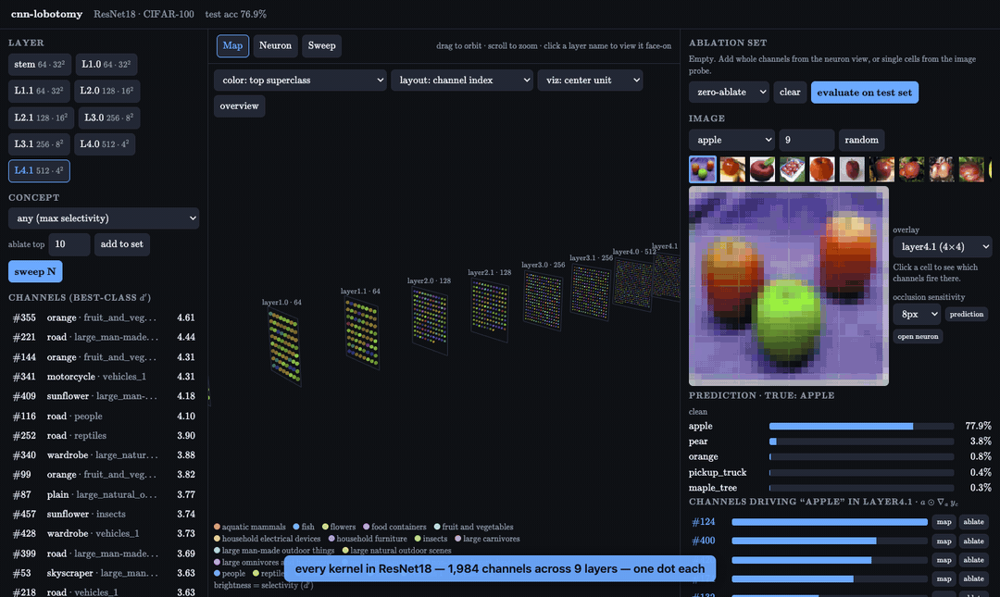

# cnn-lobotomy

An interactive explorer for poking at, and surgically removing, the individual kernels of a ResNet18 trained on CIFAR-100.

A small disclaimer before anything else: this is my first completely vibe-coded project. It has been sitting on my list of "things I would like to see someday" for a while now, but it never quite made the cut over everything else that was demanding my time. Coding agents have now gotten good enough to pull off shenanigans like this one, so I decided to finally give it a go. My role was largely supervisory, with what I hoped to see in a "lobotomizer" for a CNN, and making certain design choices, while the agent did the heavy lifting on the code :P. 



(A higher quality version of the above is in [`docs/demo.mp4`](docs/demo.mp4).)

## Overview

A question I kept coming back to while working on representational alignment was a fairly simple one: if a network has a kernel that looks like a "dog detector", what actually happens when you switch it off? Does the network forget what a dog is, or does it barely notice?

This project is my attempt at answering that for a CNN. It was inspired by [neuron-explorer](https://github.com/lyramakesmusic/neuron-explorer) by lyramakesmusic, which does something similar for the MLP neurons of a language model. In its essence, the tool does three things:

1. **Find** kernels that respond to a concept (a class like *orange*, or a superclass like *large carnivores*)
2. **Look** at what those kernels respond to, with a few different visualization techniques
3. **Silence** them (whole channels, or a single spatial position of a channel) and measure the damage on the full test set

I chose CIFAR-100 over ImageNet for the sole reason that it is far more manageable: the whole test set fits in memory, a full evaluation takes about 3 seconds on a laptop, and a model can be trained from scratch in about 40 minutes.

## Model architecture

The model is a ResNet18 adapted for 32×32 images. The only difference from the torchvision version is the stem: a 3×3 convolution with stride 1 and no max pooling, as opposed to the 7×7 stride-2 convolution followed by max pooling. Without this change, a 32×32 image would be reduced to a 1×1 map by `layer4`, which leaves very little room for spatial interpretation.

For interpretability purposes, I treat the output of the stem and of each of the 8 residual blocks as a "layer". This gives 9 layers and **1,984 kernels** in total:

| layer | channels | spatial grid | receptive field |
|---|---|---|---|
| `stem` | 64 | 32×32 | 3×3 |
| `layer1.0`, `layer1.1` | 64 | 32×32 | 7×7, 11×11 |
| `layer2.0`, `layer2.1` | 128 | 16×16 | 17×17, 25×25 |
| `layer3.0`, `layer3.1` | 256 | 8×8 | whole image |
| `layer4.0`, `layer4.1` | 512 | 4×4 | whole image |

Each block output is the residual stream after the block's final ReLU, so silencing a channel there removes it from everything downstream, including the skip connections.

### What counts as a "neuron"?

In a CNN, a "neuron" is not as well defined as it is in an MLP, since every kernel produces an entire spatial map of activations. I use two definitions depending on the job:

- **For ranking and naming kernels:** the *spatial max* of a channel's map (where it fires the hardest). This is a better fit for "detectors" than the mean, which gets diluted by the background, or the center pixel, which has no single center in `layer4`'s 4×4 grid and assumes the object is centered (CIFAR objects often are not).
- **For fine-grained work:** every individual (channel, y, x) unit. Heatmaps, probing and ablation all work at this level.

A kernel's selectivity for a class is measured with $d'$:

$$d' = \frac{\mu_{\text{in}} - \mu_{\text{out}}}{\sqrt{\tfrac{1}{2}\left(\sigma_{\text{in}}^2 + \sigma_{\text{out}}^2\right)}}$$

where $\mu$ and $\sigma^2$ are the mean and variance of the kernel's spatial max over test images inside and outside the class.

## Training

The model is trained from scratch for 40 epochs with SGD (Nesterov momentum 0.9, weight decay $5\times10^{-4}$), a one-cycle learning rate schedule peaking at 0.1, label smoothing of 0.1, and random crops and horizontal flips.

To save myself from the overhead of a `DataLoader`, the whole dataset lives on the GPU and is augmented there. Each epoch takes about 55 seconds on an M-series Mac (via MPS), and the final model reaches a **test accuracy of 76.9%**, which is roughly what one would expect from a ResNet18 on CIFAR-100 without any extra tricks.

## Features

### The map

Every kernel in the network is a dot, laid out as one sheet per layer (as in neuron-explorer). Clicking on a layer name flies the camera to a face-on view of that sheet.

- **Hover** over a kernel to see its feature visualization, its 4 top-activating test images, and the classes it is most selective for
- **Click** on a kernel to open it in the neuron view
- **Color** the dots by
  - top superclass (brightness = $d'$)
  - selectivity for a chosen concept
  - activation on the image currently loaded in the lab
  - membership in the ablation set
- **Lay out** each sheet either by channel index or by *similar class profile*, where kernels that respond to similar classes end up next to each other

### Neuron view

For any kernel, this shows:

- its feature visualization (more on this below)
- for `stem` kernels, the raw 3×3 RGB weights, since these act on pixels directly
- the classes and superclasses it is most selective for, along with the distribution of its activations
- the **Zeiler–Fergus view**: the 9 strongest units over the test set, projected back to pixel space, beside the image patches under their receptive fields
- its top 24 test images, with the channel's activation map drawn over each

### Feature visualization

The map and neuron view use two flavors of activation maximization, i.e., synthesising an input image which makes a kernel fire as much as possible:

- **Whole channel:** maximize the channel's mean activation over its entire map. This produces tiling textures, and is how the Distill article on feature visualization does it. The image is parameterized in Fourier space with a $1/f$ falloff, jittered at every step, and lightly penalized for total variation.
- **Center unit** (the default): maximize the single unit at the center of the map. The image is constrained to be gray plus a perturbation of bounded $L_2$ norm, and the objective is taken before the block's final ReLU (otherwise units that start out negative never receive any gradient). Each result is cropped to the unit's receptive field.

I initially only had the whole-channel version, and the stem kernels came out as flat, saturated colors, which looked nothing like the edge detectors I was expecting. The reason is that the stem is linear before its ReLU, and maximizing a linear function over the whole image just pushes every pixel towards the kernel's average color. With the center-unit objective, the optimum for a linear layer *is* its kernel, which I verified: across all 64 stem kernels, the median cosine similarity between the visualization and the actual weights is 0.998.

The deeper layers (`layer3` onwards) are noisy no matter which flavor is used. This is expected from a network that has not been trained to be adversarially robust, and is the reason why the real image patches are shown alongside.

### Zeiler–Fergus projections

This is the visualization from the paper *Visualizing and Understanding Convolutional Networks* (Zeiler & Fergus). For each of a kernel's top 9 test images, every activation in the layer except the strongest unit is zeroed, and the result is run back down to pixel space.

The paper uses a *deconvnet* for the backward pass, which only passes positive signal through each ReLU and ignores which units were active on the forward pass. While implementing it, I found that this makes the projections identical for every input image in a ResNet. In the original architecture, the only image-specific information in the backward pass came from the max-pooling "switches", and this ResNet does not have max pooling. So the default here is **guided backprop**, which also respects the forward-pass ReLU masks, and does produce image-specific projections: the orange kernel `layer4.1 #355` traces the outline of each fruit, and a sunflower kernel in `layer3.1` traces the disc and the petals. The deconvnet is still available from a dropdown, should anybody wish to see the failure for themselves :)

### Ablation lab

This is where the lobotomy happens. An image from the test set is loaded on the right-hand side, along with the model's top-5 predictions.

- **Probe:** click on any cell of the image (at the resolution of the selected layer) to list the channels firing at that position. From there, a channel can be silenced at just that one position, or everywhere.
- **Ablation set:** any number of whole channels and individual (channel, y, x) units from any layer. Predictions before and after are shown side by side.
- **Zero vs. mean ablation:** silenced units are either set to 0 or to their average value over the test set. The difference matters more than one would think (see results).
- **Attribution:** the channels pushing the model towards its prediction, ranked by $\sum_{y,x} a \odot \nabla_a\, y_c$ (activation times gradient of the class logit), with a spatial map for each.
- **Occlusion sensitivity:** slide a gray square (4, 8 or 12 pixels) across the image and see where the prediction's probability (or the open kernel's activation) drops. This is the other experiment from the Zeiler–Fergus paper.
- **Evaluate on test set:** re-runs all 10,000 test images with the current ablation set, and reports the overall accuracy, the most damaged classes and superclasses, and which classes the changed predictions went to.

### Sweep

To answer "how many kernels does it take to break a concept?", the sweep ablates the top-$N$ kernels for a concept (ranked by $d'$) at one layer, for $N \in \{1, 2, 3, 5, 8, 13, 20, 30, 50, 80, 128, 200\}$ (capped below the layer's size). For each $N$, it records:

- the concept's accuracy with zero ablation and with mean ablation
- the concept's accuracy when $N$ *random* kernels are zeroed instead, as a control
- the accuracy on every other class

It reports the first $N$ at which the drop is statistically significant (an exact one-sided McNemar test on the paired predictions, $p < 0.05$), the first $N$ at which the concept's accuracy is halved, and the first $N$ at which the other classes lose 2 points.

## Results

So far I have mostly played around with the class *orange* (95% baseline accuracy), which has some fairly obvious detectors.

**Final layer (`layer4.1`):** the single most selective kernel, #355, has a $d'$ of 4.61 for orange. Silencing it on its own only drops orange to 93%, with most of the lost images being predicted as apples. Silencing the top 10 brings it down to 85%, mostly to *sweet pepper*, *apple*, *tulip* and *pear*. Under zero ablation, orange accuracy is halved at $N=50$ and reaches 0% at $N=80$, while the other 99 classes barely move (76.7% to 76.2%).

That looks like a clean "orange circuit", but mean ablation tells a different story: orange bottoms out at about 72% and never drops further. This is because `layer4.1` is followed only by average pooling and the final linear layer, so zeroing the orange kernels mostly just deletes the positive weight going into the orange logit. Mean ablation removes the *information* in the kernels instead, and the remaining ~400 kernels turn out to carry more than enough of it. In other words, at the last layer the concept is heavily redundant.

**Middle layer (`layer2.0`):** here, zero and mean ablation agree, and orange is halved at $N = 13$ (out of 128 kernels) and gone by $N = 30$, while 13 random kernels only bring it down to 82%. However, the other classes start losing accuracy at $N = 8$. The top 13 orange kernels take 51 points off orange, but also 28 points off *woman* and 25 off *crab*. At this depth, the kernels encode things like color and texture which many classes rely on, so the lobotomy is much less surgical.

The takeaway so far: concepts are concentrated but entangled early on, and specific but redundant later.

## Running it

### Requirements

Python 3.11, PyTorch 2.4, torchvision, NumPy and Pillow. Nothing else is needed on the Python side: the server uses the standard library's HTTP server, so there is no web framework to install. The front end loads three.js and KaTeX from a CDN, so an internet connection is needed for the browser.

### Steps

I have not published the trained weights (maybe at some point later, if there is a need for it), so the model has to be trained from scratch first:

```bash
python train.py          # downloads CIFAR-100 (~170 MB) and trains (~40 min on an M-series Mac)
python build_index.py    # per-kernel statistics over the test set (~1 min)
python feature_viz.py    # both feature visualization flavors, every layer (~10 min)
python server.py         # then open http://localhost:8000
```

`train.py` picks CUDA, MPS or the CPU automatically. `feature_viz.py` takes `--mode channel|center|both` and an optional list of layers.

### Files

| file | what it does |
|---|---|
| `model.py` | the CIFAR ResNet18, plus a switchable ReLU backward pass for deconvnet / guided backprop |
| `train.py` | training, with the dataset and augmentation on the GPU |
| `build_index.py` | spatial-max activations, top images, per-class means and $d'$ for every kernel |
| `feature_viz.py` | activation maximization, saved as one sprite sheet per layer and flavor |
| `server.py` | HTTP + JSON server: ablation hooks, probing, attribution, projections, occlusion, evaluation and sweeps |
| `static/index.html` | the interface |
| `static/map.js` | the three.js map |

Trained weights, the cached index and the dataset are excluded from git (`checkpoints/`, `cache/`, `data/`).

## Future scope

- **Sparse autoencoders.** Many kernels respond to several unrelated things (#355 is also fairly selective for rockets and hamsters). A sparse dictionary trained on `layer4` activations would likely give cleaner features to silence than raw channels.
- **Bigger models and ImageNet.** Everything here is architecture agnostic apart from the receptive field bookkeeping, and ImageNet would give much more natural concepts than CIFAR's 100 classes (along with actual dogs).
- **A better random control.** The sweep currently uses a single fixed random ordering of kernels, which is one sample rather than a distribution.
- **Circuits across layers.** At the moment, ablations are measured at the output. Tracing how silencing a `layer2` kernel changes the `layer4` kernels downstream of it would be the natural next step.

## References

- M. D. Zeiler and R. Fergus. *Visualizing and Understanding Convolutional Networks*. ECCV 2014. [arXiv:1311.2901](https://arxiv.org/abs/1311.2901)
- J. T. Springenberg, A. Dosovitskiy, T. Brox and M. Riedmiller. *Striving for Simplicity: The All Convolutional Net*. ICLR 2015 workshop (guided backprop). [arXiv:1412.6806](https://arxiv.org/abs/1412.6806)
- C. Olah, A. Mordvintsev and L. Schubert. *Feature Visualization*. Distill, 2017. [distill.pub/2017/feature-visualization](https://distill.pub/2017/feature-visualization/)
- K. He, X. Zhang, S. Ren and J. Sun. *Deep Residual Learning for Image Recognition*. CVPR 2016. [arXiv:1512.03385](https://arxiv.org/abs/1512.03385)
- D. Bau, B. Zhou, A. Khosla, A. Oliva and A. Torralba. *Network Dissection: Quantifying Interpretability of Deep Visual Representations*. CVPR 2017. [arXiv:1704.05796](https://arxiv.org/abs/1704.05796)
- B. Zhou, Y. Sun, D. Bau and A. Torralba. *Revisiting the Importance of Individual Units in CNNs via Ablation*. 2018. [arXiv:1806.02891](https://arxiv.org/abs/1806.02891)
- W. Nie, Y. Zhang and A. Patel. *A Theoretical Explanation for Perplexing Behaviors of Backpropagation-based Visualizations*. ICML 2018. [arXiv:1805.07039](https://arxiv.org/abs/1805.07039)
- A. Krizhevsky. *Learning Multiple Layers of Features from Tiny Images*. 2009 (CIFAR-100).
- [neuron-explorer](https://github.com/lyramakesmusic/neuron-explorer) by lyramakesmusic, which this project borrows its map from.
